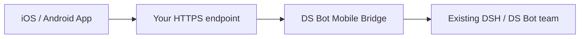

<h1 align="center">DS Bot Mobile App</h1>

<p align="center">Your existing Bot team, on your phone.</p>

<p align="center">
  <a href="https://github.com/MuQY1818/ds-bot-mobile-app/actions/workflows/check.yml"></a>
  <a href="https://github.com/MuQY1818/ds-bot-mobile-app/releases/tag/v0.1.2-preview.1"></a>
  <a href="LICENSE"></a>
</p>

<p align="center">
  <a href="README.md">简体中文</a> · English · <a href="docs/installation.md">Installation</a> · <a href="https://github.com/MuQY1818/ds-bot-mobile-app/releases">Releases</a> · <a href="https://github.com/MuQY1818/ds-bot-mobile-app/issues">Issues</a>
</p>

DS Bot Mobile App is a native iOS / Android client for self-hosted [DeepSeek Harness](https://github.com/deepseek-ai/deepseek-harness) (DSH) and [DS Bot](https://github.com/Fei2411/DeepSeek-Bot). A separate **DS Bot Mobile Bridge** connects your phone to the existing team, conversations and supported host controls. Models and tools continue running on the computer.

> **Source preview**: `0.1.2-preview.1` includes Mobile Bridge `0.0.6`. Releases provide the Bridge, a compatible DS Bot package and checksums. **Signed IPA/APK builds are not available**; build the native client with your own platform toolchain. For browser access, use [DS Bot Mobile Web](https://github.com/MuQY1818/ds-bot-mobile-web).

## Preview

<p align="center">
  
  
  
</p>

*Conversation list, direct chat and group chat. These design previews use synthetic data rendered by the actual React Native components on the Web. See [design notes](docs/design.md).*

## Features

- **Existing conversations**: access Bots and groups, exchange text and read attributed member replies.
- **Native interaction**: screen navigation, back gestures, message scrolling, character avatars, light/dark themes and English/Chinese interfaces.
- **Device authorization**: pairing approved by the computer owner, with individual device revocation.
- **Reconnection and drafts**: synchronize history after reconnecting, retain local drafts and let the user decide when to send.
- **Host controls**: models and reasoning effort, conversation flags, Usage, own memory, schedule creation/listing/deletion and viewing/removing your own queued input.

Features follow Bridge capability discovery. Current push events arrive **after a complete message is committed**. Token streaming, native tool approvals, media/voice, APNs, group administration and schedule editing are not available. See the [capability matrix](docs/validation.md).

## How it works



Bridge installs as a standard DSH bundle and waits for owner configuration. Configure dedicated storage and HTTPS, then approve pairing on the computer. Message caches and drafts live on the client; device credentials use the platform's secure store.

## Development status

Bridge text transport is available. Desktop pairing management, signed App distribution and physical-device acceptance remain incomplete; installation currently requires a development environment and manual configuration. See [Development status](docs/status.md).

## Quick start

### Requirements

| Component | Requirement |
| --- | --- |
| Host | DSH `0.2.1-rc.2` and a compatible DS Bot package |
| Bridge | `ds-bot-mobile-bridge-0.0.6.tgz` from the same release |
| Network | Phone-accessible HTTPS with a trusted certificate |
| Development | Git, Node.js 24 and npm; Python 3 for the source audit |
| iOS build | macOS and Xcode; your own signing identity for a device |
| Android build | Android SDK and its build toolchain |

**Compatibility prerequisite**: Bridge requires `bridge.describe`, stable `bridge.submit` and `bridge.redact` interfaces. The pristine npm DS Bot `0.1.7` does not provide them. This project's [release](https://github.com/MuQY1818/ds-bot-mobile-app/releases/tag/v0.1.2-preview.1) includes a separately identified `ds-bot-0.1.7-codex.1.tgz`. See [installation](docs/installation.md) for profile selection and migration.

### 1. Prepare the computer

Download the compatible DS Bot package, Bridge and `SHA256SUMS` from the same release. Verify the archives and install them through the existing DSH plugin manager. Set dedicated storage, the listener and an HTTPS endpoint using the [Bridge example](bridge/cordis.patch.example.yml), then create pairing through the [owner API](docs/bridge.md#owner-operations).

### 2. Build the client

```sh
git clone https://github.com/MuQY1818/ds-bot-mobile-app.git
cd ds-bot-mobile-app
npm run setup
```

Build a development client for one platform:

```sh
npm --prefix apps/mobile run ios
# or
npm --prefix apps/mobile run android
```

The project includes custom native modules; use a development build. Platform setup and signing requirements are described in the [client README](apps/mobile/README.md).

### 3. Pair and connect

Scan the pairing details in the App, verify the host identity and approve the request on the computer. Confirm that the devices can reach each other, then open an existing conversation. See [installation](docs/installation.md) for full configuration, migration and rollback steps.

## Development and contributions

After `npm run setup`, run from the repository root:

```sh
npm --prefix bridge run test:prepare
npm run check
npm --prefix bridge run test:integration
npm run audit
```

Tests use pinned public dependencies, mock models and isolated hosts. See [development](docs/development.md) for packaging and native validation. Report reproducible problems in [Issues](https://github.com/MuQY1818/ds-bot-mobile-app/issues), or follow the [contribution guide](CONTRIBUTING.md).

## Documentation and layout

The detailed project guides are currently in Simplified Chinese; client, SDK and Bridge READMEs are available in English.

| Entry | Contents |
| --- | --- |
| [Installation](docs/installation.md) | Host setup, client builds, pairing, migration and rollback |
| [Development](docs/development.md) | Environment, isolated checks and packaging |
| [Compatibility and validation](docs/validation.md) | Capabilities, evidence scope and known limitations |
| [Design](docs/design.md) | Layout, message attribution and development preview |
| [Provenance](docs/provenance.md) | Upstream revisions and reviewed changes |
| [apps/mobile](apps/mobile/README.md) | Expo / React Native client |
| [packages/mobile-sdk](packages/mobile-sdk/README.md) | Protocol, transport, receipts and cache SDK |
| [bridge](bridge/README.md) | Standalone DSH Bridge, configuration and owner API |

## Current limitations

This is a source preview. Automated tests, Hermes bundle exports and Web design previews have distinct scopes. The full iPhone / Android device installation, keyboard, lock-screen, network-transition and notification matrix remains incomplete. DSH also has upstream limitations around pending-input recovery across restarts. See [validation](docs/validation.md).

## License and acknowledgments

Derived from [QingJ01/DS-Bot-App](https://github.com/QingJ01/DS-Bot-App) and [Fei2411/DeepSeek-Bot](https://github.com/Fei2411/DeepSeek-Bot), under [Apache License 2.0](LICENSE). Original attribution and third-party notices are retained in [NOTICE](NOTICE) and the [provenance record](docs/provenance.md).

Independent community project; not affiliated with DeepSeek.
