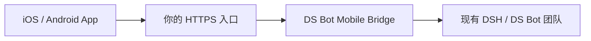

<h1 align="center">DS Bot Mobile App</h1>

<p align="center">把电脑上的 Bot 团队，带到手机上。</p>

<p align="center">
  <a href="https://github.com/MuQY1818/ds-bot-mobile-app/actions/workflows/check.yml"></a>
  <a href="https://github.com/MuQY1818/ds-bot-mobile-app/releases/tag/v0.1.2-preview.1"></a>
  <a href="LICENSE"></a>
</p>

<p align="center">
  简体中文 · <a href="README.en.md">English</a> · <a href="docs/installation.md">安装指南</a> · <a href="https://github.com/MuQY1818/ds-bot-mobile-app/releases">发布版本</a> · <a href="https://github.com/MuQY1818/ds-bot-mobile-app/issues">反馈</a>
</p>

DS Bot Mobile App 是连接自托管 [DeepSeek Harness](https://github.com/deepseek-ai/deepseek-harness)（DSH）与 [DS Bot](https://github.com/Fei2411/DeepSeek-Bot) 的 iOS / Android 原生客户端。通过独立的 **DS Bot Mobile Bridge**，手机可以访问现有团队、会话和宿主支持的管理功能；模型与工具仍在电脑端运行。

> **源码预览**：当前版本为 `0.1.2-preview.1`，包含 Mobile Bridge `0.0.6`。发布页提供 Bridge、兼容 DS Bot 包与校验值，**尚未提供签名 IPA/APK**。原生客户端需使用自己的平台工具链构建。需要浏览器访问时，可选择 [DS Bot Mobile Web](https://github.com/MuQY1818/ds-bot-mobile-web)。

## 界面预览

<p align="center">
  
  
  
</p>

*会话列表、单聊与群聊。图片采用虚构数据，由实际 React Native 组件在 Web 渲染；属于设计预览。设计说明见 [docs/design.md](docs/design.md)。*

## 主要功能

- **延续现有会话**：访问 Bot 与群聊，收发文字，查看带成员署名的回复。
- **原生交互**：页面导航、返回手势、消息滚动、精灵头像、深浅主题与中英文界面。
- **设备独立授权**：电脑所有者批准配对，可单独撤销设备访问。
- **连接恢复与草稿**：恢复连接后同步历史，保留本地草稿，发送由用户确认。
- **宿主能力集成**：模型与思考强度、会话标记、Usage、个人记忆、定时任务创建/查看/删除及自己的排队输入查看/移除。

功能以 Bridge 的能力声明为准。当前消息推送发生在**完整消息提交后**；逐 token 推送、原生工具审批、媒体/语音、APNs、群管理及定时任务修改尚未提供。完整矩阵见[兼容与验证](docs/validation.md)。

## 工作方式



Bridge 作为标准 DSH bundle 安装，默认等待所有者配置。配置独立状态目录与 HTTPS 后，由电脑批准手机配对。消息缓存与草稿保存在客户端；设备凭据使用平台安全存储。

## 开发状态

Bridge 的文字链路已具备，但电脑端配对管理界面、签名 App 分发与真机验收仍待完成。当前安装需要开发环境与手动配置；详细进度见[开发状态](docs/status.md)。

## 快速开始

### 环境要求

| 组件 | 要求 |
| --- | --- |
| 宿主 | DSH `0.2.1-rc.2` 与兼容 DS Bot 包 |
| Bridge | 同次发布的 `ds-bot-mobile-bridge-0.0.6.tgz` |
| 网络 | 手机可达、证书可信的 HTTPS 入口 |
| 开发环境 | Git、Node.js 24、npm；源码审计需 Python 3 |
| iOS 构建 | macOS、Xcode；真机使用自己的签名身份 |
| Android 构建 | Android SDK 与对应构建工具链 |

**兼容性前提**：Bridge 依赖 `bridge.describe`、稳定的 `bridge.submit` 与 `bridge.redact` 接口。原版 npm DS Bot `0.1.7` 不包含这些接口；本项目[发布页](https://github.com/MuQY1818/ds-bot-mobile-app/releases/tag/v0.1.2-preview.1)提供单独标识的 `ds-bot-0.1.7-codex.1.tgz`。安装位置与迁移步骤见[安装指南](docs/installation.md)。

### 1. 准备电脑端

从同次 Release 下载兼容 DS Bot 包、Bridge 包与 `SHA256SUMS`，核对校验值后，通过现有 DSH 插件管理器安装。按[Bridge 配置示例](bridge/cordis.patch.example.yml)设置独立状态目录、监听地址及 HTTPS 入口，再通过[所有者接口](docs/bridge.md#所有者操作)创建配对。

### 2. 构建客户端

```sh
git clone https://github.com/MuQY1818/ds-bot-mobile-app.git
cd ds-bot-mobile-app
npm run setup
```

选择一个平台构建开发客户端：

```sh
npm --prefix apps/mobile run ios
# 或
npm --prefix apps/mobile run android
```

项目包含自定义原生模块，请使用开发构建。平台准备与签名说明见[客户端文档](apps/mobile/README.md)。

### 3. 配对并连接

在 App 扫描电脑生成的配对资料，核对主机身份，并在电脑上批准请求。首次使用建议先确认手机与电脑网络互通，随后打开一个已有会话。完整配置、迁移与回退步骤见[安装指南](docs/installation.md)。

## 开发与贡献

在完成 `npm run setup` 后，从仓库根目录运行：

```sh
npm --prefix bridge run test:prepare
npm run check
npm --prefix bridge run test:integration
npm run audit
```

测试使用固定公开依赖、mock 模型和隔离宿主。开发环境、打包与原生验证说明见[开发指南](docs/development.md)。欢迎通过 [Issues](https://github.com/MuQY1818/ds-bot-mobile-app/issues) 报告可复现的问题，或按[贡献指南](CONTRIBUTING.md)提交改进。

## 文档与项目结构

| 入口 | 内容 |
| --- | --- |
| [安装指南](docs/installation.md) | 宿主配置、客户端构建、配对、迁移与回退 |
| [开发指南](docs/development.md) | 环境准备、隔离测试与打包 |
| [兼容与验证](docs/validation.md) | 能力矩阵、验证层级与已知限制 |
| [设计说明](docs/design.md) | 布局、消息归属与开发预览 |
| [来源记录](docs/provenance.md) | 上游版本、审查范围与修改来源 |
| [apps/mobile](apps/mobile/README.md) | Expo / React Native 客户端 |
| [packages/mobile-sdk](packages/mobile-sdk/README.md) | 协议、连接、回执与缓存 SDK |
| [bridge](bridge/README.zh.md) | 独立 DSH Bridge、配置与所有者接口 |

## 当前限制

本项目仍处于源码预览阶段。自动化测试、Hermes bundle 导出和 Web 设计预览各自有明确范围；iPhone / Android 真机安装、键盘、锁屏、网络切换及通知矩阵尚未完成。DSH 跨重启的 pending 恢复也存在上游限制。详见[验证说明](docs/validation.md)。

## 许可与致谢

基于 [QingJ01/DS-Bot-App](https://github.com/QingJ01/DS-Bot-App) 与 [Fei2411/DeepSeek-Bot](https://github.com/Fei2411/DeepSeek-Bot)，采用 [Apache License 2.0](LICENSE)。原始署名与第三方声明保留于 [NOTICE](NOTICE) 和[来源记录](docs/provenance.md)。

本项目为独立社区项目，与 DeepSeek 官方无隶属关系。
