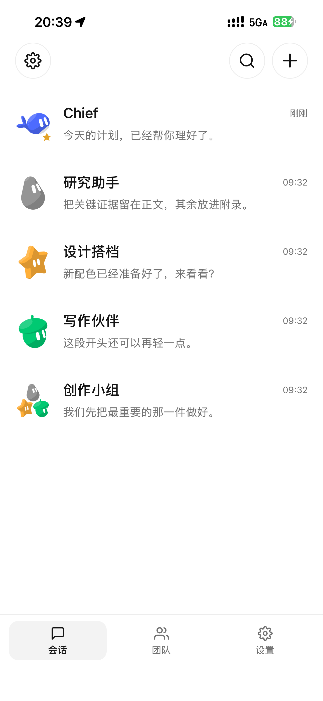
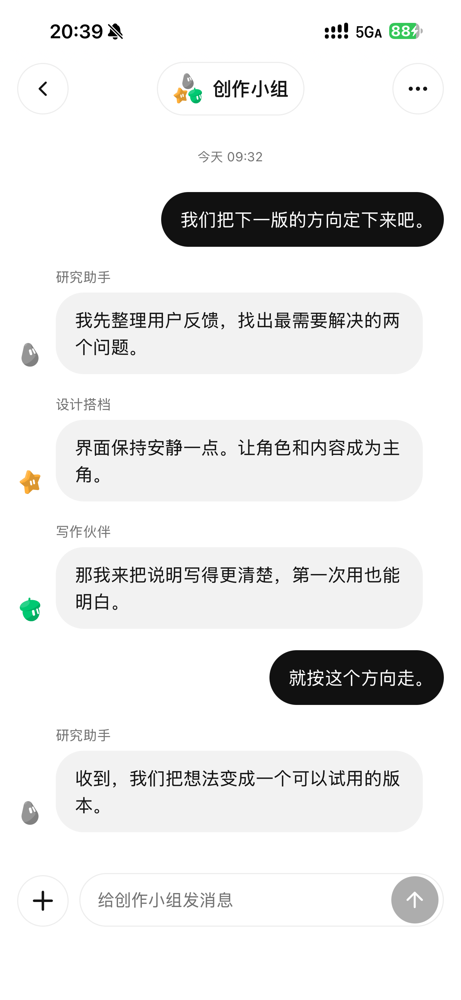
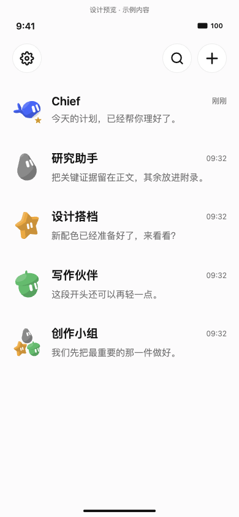
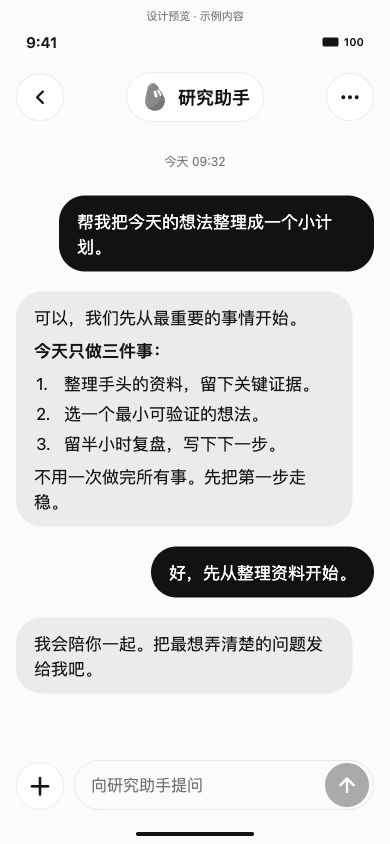
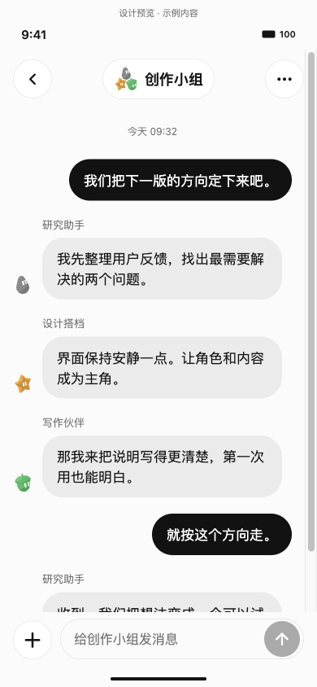

# 移动端交互设计

本轮参考用户提供的移动消息界面，保留 DS Bot 自己的原始角色和配色。重点是少量悬浮控件、安静的背景与清晰的消息归属。

- 会话列表：48px 角色头像、19px 名称、单行预览与时间；Main Bot 使用小标记，避免顶部大头像挤占列表。
- 单聊：顶部返回 / 居中身份胶囊 / 更多；用户黑色气泡、Bot 浅灰气泡，正文 17px / 25px。
- 群聊：组合头像与名称，气泡上方标明发言者，左侧小头像帮助辨认；不按角色颜色改变正文底色。
- 输入：独立加号和胶囊输入框，最小触控 44px；保留 safe area、原生键盘避让、滚动恢复和返回手势。
- 暗色主题保持消息归属的对比；减弱动画设置继续生效。实际可用功能以主机能力为准。

## iPhone 真机界面

以下三张图片来自真实 iPhone，展示会话列表、单聊与群聊。截图使用独立 staging 中的示例数据，不读取生产主机或用户会话；所用共享原生组件与公开 App `0.1.3` 相同。

<p align="center">
  
  
  
</p>

这些图片证明原生界面在 iPhone 上的实际渲染。真实主机连接、消息收发、键盘、锁屏和网络切换等能力分别验收，不能由示例截图推定。当前已完成的设备检查见[兼容与验证](validation.md#iphone-设备验证)；Android 真机验证仍待完成。

## Web 组件设计预览

ChatHeader 和 MessageBubble 在实际 App 与设计预览之间共享。以下是实际 React Native 组件在 Web 中渲染的会话列表、单聊与群聊，使用**示例数据**。预览用于检查布局、搜索、导航和输入；不连接主机、不保存设备凭据，不表示用户实际会话或模型输出。

<p align="center">
  
  
  
</p>

```sh
cd apps/mobile
EXPO_PUBLIC_DS_BOT_DESIGN_PREVIEW=1 npx expo start --web --host localhost --port 8108
```

仅开发构建且显式设置该环境变量才进入预览，正常构建仍进入配对与真实会话。这里的 Web 渲染用于快速检查布局；iPhone 真机图片与安装检查单独记录。键盘、锁屏和网络切换仍需相应的原生场景验收。

## 电脑端手机访问

账户菜单只显示一个“手机访问”，500px 紧凑弹窗中用 Web / App 标签切换。标题与关闭按钮属于共享壳，连接状态位于内容区，不进入宿主设置工具栏。App 内容使用分隔线和设备行；没有待批准请求时不显示空卡片，配对说明按需展开。Web 内容保留扫码和复制登录链接。

两插件分别提供模式，任一独立启用仍可使用。切换模式与关闭弹窗卸载内容并取消本模式请求、清理二维码。保留键盘 tabs、Esc、焦点约束与返回焦点，窄屏及短横屏内容独立滚动。

README 的手机主图使用本页的 iPhone 真机示例图；电脑端配图来自实际部署的 App 配套插件，保留完整窗口与“手机访问 → App”弹窗，截图时没有显示配对二维码。电脑端配图与 Web 组件预览的来源及隐私处理见[图片说明](images/README.md)。图片中不包含生产主机地址、设备标识、签名资料或访问凭据。
