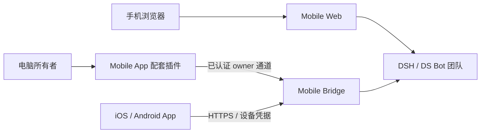

# 插件职责与生命周期

DS Bot 的移动访问分为三个独立的电脑端插件。它们使用 DSH 公开的 bundle、slot、Connection 和 WebServer 接口，由现有插件管理器分别安装、选择、停用和移除。原生 App 是手机上的客户端，与电脑端插件分别构建和分发。

## 组件边界

| 组件 | 包名 / 位置 | 负责 | 依赖 |
| --- | --- | --- | --- |
| Mobile Web | `ds-bot-mobile-web`，[独立仓库](https://github.com/MuQY1818/ds-bot-mobile-web) | 手机浏览器界面、手机访问入口和浏览器会话体验 | 已有 DSH Web / DS Bot |
| Mobile App 电脑端配套 | `ds-bot-mobile-app`，[companion](../companion/README.md) | Bridge 状态、配对二维码、批准/拒绝请求、设备撤销 | 已配置的 Mobile Bridge |
| Mobile Bridge | `ds-bot-mobile-bridge`，[bridge](../bridge/README.zh.md) | 设备认证、HTTP/WS、能力适配与独立授权存储 | 兼容 DS Bot 窄接口 |
| 原生 App | [apps/mobile](../apps/mobile/README.md) | iOS / Android 页面、安全凭据存储、消息缓存与草稿 | 手机可达的 Bridge HTTPS 入口 |

App 配套插件和 Bridge 在同一源码仓库维护，分别发布 `.tgz`。它们各自的版本与许可证清单写入包内 `package.json`；原生 App 的版本写入 `apps/mobile/app.json`。共享仓库不会将它们变成一个必须一起启停的插件。

## 访问链路

Web 使用宿主浏览器认证，App 使用单独批准的设备身份。两种二维码不可互换。Web 无需 App 或 Bridge；原生 App 无需 Web 插件。配套插件本身不创建监听端口、隧道、第二份 Bot 运行时或设备密钥库。

## 启停与移除

| 操作 | 结果 |
| --- | --- |
| 停用 Mobile Web | 退出移动布局扩展；宿主与 App Bridge 按其自身状态运行 |
| 停用 Mobile App 配套插件 | 移除配对管理页面并清理页面内二维码、定时器和进行中的请求；Bridge 与已授权设备保持独立 |
| 停用 Bridge | 释放 Bridge 监听和所有者操作通道；App 连接暂不可用，配套插件提示准备 Bridge |
| 重新启用 Bridge | 使用原独立 `home` 时恢复服务器身份与未撤销设备授权 |
| 移除 App 配套插件 | 移除这一 bundle；不会删除 Bridge `home` 或 DS Bot 团队数据 |
| 撤销某一设备 | 由 Bridge 撤销该设备；需要重新配对才能恢复访问 |

隐藏或关闭二维码只清除当前页面显示，不会撤销已复制的资料。未使用配对码两分钟后过期；生成新码会替换之前未使用的码。设备请求仍须电脑所有者明确批准；撤销设备还有二次确认。

更新或移除 Bridge 前先等待宿主空闲，保留配置和独立状态目录。DSH 的跨重启排队输入恢复属于上游限制，插件不能保证替宿主恢复 pending 输入。完整步骤见[安装指南](installation.md)。

## English

The three desktop bundles are independently installable: **Mobile Web** supplies the browser interface, **Mobile App** supplies desktop pairing/device management, and **Mobile Bridge** supplies device authentication and transport. The native iOS / Android App remains a separate client. App companion and Bridge share a source repository but have separate package manifests, versions and archives.

Web uses host browser authentication and requires neither App nor Bridge. The native App uses owner-approved device credentials and does not require Mobile Web. Disabling or removing App companion cleans up its UI without owning the Bridge listener or deleting authorization state. Disabling Bridge stops transport; re-enabling with the same dedicated state directory retains the host identity and authorized devices. Revocation is an explicit owner action. Hiding a QR code clears only its display; unused codes expire after two minutes and a new code replaces earlier unused codes.

Only public DSH bundle/slot/Connection/WebServer APIs are used. No DSH core patch or second Bot runtime is introduced. Automated fixture evidence, local deployment evidence and physical-device acceptance have separate scopes; see [validation](validation.md).
