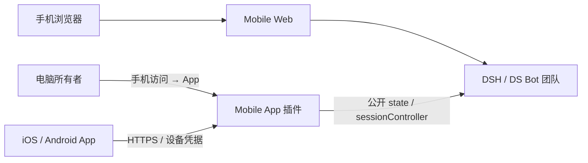

# 插件职责与生命周期

DS Bot 的移动访问只有**两个电脑端插件**：Mobile Web 与 Mobile App。它们使用 DSH 公开的 bundle、slot、Connection 和 WebServer 接口，由现有插件管理器分别安装、选择、停用和移除，均直接适配官方 DS Bot 0.2.6（不打补丁）。原生 App 是手机上的客户端，与电脑端插件分别构建和分发。原独立的 Mobile Bridge 自 App 插件 0.3.0 起并入 App 插件。

## 组件边界

| 组件 | 包名 / 位置 | 负责 | 依赖 |
| --- | --- | --- | --- |
| Mobile Web | `ds-bot-mobile-web`，[独立仓库](https://github.com/MuQY1818/ds-bot-mobile-web) | 手机浏览器界面、手机访问入口和浏览器会话体验 | 已有 DSH Web / DS Bot |
| Mobile App 电脑端插件 | `ds-bot-mobile-app`，[companion](../companion/README.md) | 配对二维码、批准/拒绝请求、设备撤销；设备认证、HTTP/WS 传输、能力适配与独立授权存储 | DSH 0.2.1-rc.5+、官方 DS Bot 0.2.6+ |
| 原生 App | [apps/mobile](../apps/mobile/README.md) | iOS / Android 页面、安全凭据存储、消息缓存与草稿 | 手机可达的 App 插件 HTTPS 入口 |

App 插件与支持共享入口的 Mobile Web 共用账户菜单中的 **手机访问** 入口。双启用时弹窗显示 **Web / App** 标签；只启用其中一个时仅显示对应方式。两个包保留独立版本、配置、认证接口和生命周期。官方 `plugins.bundle.config` 页面提供打开同一弹窗的备用按钮。

## 访问链路

Web 使用宿主浏览器认证，App 使用单独批准的设备身份。两种二维码不可互换。Web 无需 App 插件；原生 App 无需 Web 插件。App 插件不创建隧道、第二份 Bot 运行时，也不修改 DS Bot。

## 启停与移除

| 操作 | 结果 |
| --- | --- |
| 停用 Mobile Web | 退出移动布局扩展；宿主与 App 插件按其自身状态运行 |
| 停用 Mobile App 插件 | 关闭监听和所有者操作通道，清理页面内二维码、定时器和进行中的请求；`home` 中的授权保留 |
| 重新启用 Mobile App 插件 | 使用原 `home` 时恢复服务器身份与未撤销设备授权，手机无需重新配对 |
| 移除 Mobile App 插件 | 移除这一 bundle；不会删除其 `home` 或 DS Bot 团队数据 |
| 撤销某一设备 | 由 App 插件撤销该设备；需要重新配对才能恢复访问 |

隐藏或关闭二维码只清除当前页面显示，不会撤销已复制的资料。未使用配对码两分钟后过期；生成新码会替换之前未使用的码。设备请求仍须电脑所有者明确批准；撤销设备还有二次确认。

更新或移除 App 插件前先等待宿主空闲，保留配置和独立状态目录。DSH 的跨重启排队输入恢复属于上游限制，插件不能保证替宿主恢复 pending 输入。完整步骤见[安装指南](installation.md)。

## English

There are two desktop bundles: **Mobile Web** supplies the browser interface; **Mobile App** supplies desktop pairing/device management together with device authentication and transport (the former Mobile Bridge, merged in 0.3.0). Both work with pristine npm DS Bot 0.2.6+. The native iOS / Android App is a separate phone client.

Mobile App and a compatible Mobile Web share **Phone access** in the account menu. Both enabled: **Web / App** tabs. Either enabled alone: its own mode remains available.

Web uses host browser authentication and does not require the App plugin. The native App uses owner-approved device credentials and does not require Mobile Web. Disabling the App plugin closes its listener but keeps authorization in its `home`; re-enabling restores paired devices without re-pairing.

Only public DSH bundle/slot/Connection/WebServer APIs are used. No DSH or DS Bot patch and no second Bot runtime is introduced. Automated fixture evidence, local deployment evidence and physical-device acceptance have separate scopes; see [validation](validation.md).

## 共享入口协议

两包包含相同的 `mobile-access-registry.mjs`、`mobile-access-shell.mjs` 与样式；浏览器通过版本化 `Symbol.for('ds-bot.mobile-access.v1')` 协调 provider。registry 只保存标签、渲染函数和导航状态，不接收二维码或凭据。确定性 leader 负责唯一菜单和弹窗，leader 停用时剩余包接管；最后一个包停用后清空 registry、菜单、样式和监听。切换标签会卸载旧模式，由各模式取消请求并清理页面内凭据。

新统一入口版本应配套升级；更早的包没有共享入口协议，混用旧版仍可能显示旧入口。认证流程保持分别处理，Web 登录码不用于 App 配对。
